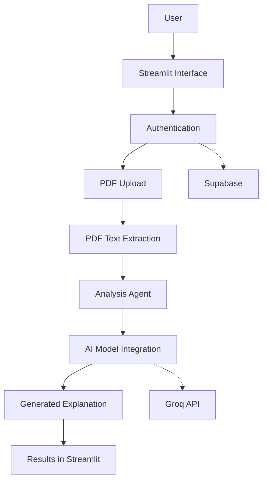

# 🩺 HealthMate AI
### AI-Powered Health Report Assistant

<p align="center">
  An intelligent, user-friendly application designed to help people understand information contained in their health reports.
</p>

<p align="center">
  
  
  
  
  
</p>

---

## 📌 Table of Contents

- [About the Project](#-about-the-project)
- [Problem Statement](#-problem-statement)
- [Project Objectives](#-project-objectives)
- [Key Features](#-key-features)
- [How It Works](#-how-it-works)
- [Technology Stack](#-technology-stack)
- [System Architecture](#-system-architecture)
- [Product Requirements Document](#-product-requirements-document-prd)
- [Project Structure](#-project-structure)
- [Installation and Setup](#-installation-and-setup)
- [Future Enhancements](#-future-enhancements)
- [Limitations and Disclaimer](#-limitations-and-disclaimer)
- [Acknowledgments](#-acknowledgments)

---

## 🧠 About the Project

**HealthMate AI** is an AI-powered health report assistant built with Python and Streamlit.

The application aims to make health-report information easier to understand by allowing users to upload PDF reports and receive AI-generated explanations.

It combines document processing, language-model capabilities, and a simple user interface to create an accessible health-information assistant.

The project is intended as an educational and informational software application, not a medical diagnosis system.

## 🎯 Problem Statement

Health reports often contain technical terminology, abbreviations, and numerical measurements that may be difficult for ordinary users to understand.

HealthMate AI aims to address this usability problem by providing a simpler way to explore and understand information extracted from health documents.

## 🚀 Project Objectives

- Simplify the process of understanding health-report information.
- Support PDF-based report uploads.
- Use AI to generate accessible explanations.
- Provide a straightforward application interface.
- Organize application functionality into reusable Python modules.
- Explore the practical integration of AI, document processing, and backend services.

## ✨ Key Features

| Feature | Description |
|---|---|
| PDF Upload | Upload supported health reports in PDF format. |
| Document Extraction | Extract text from uploaded PDF documents. |
| AI Analysis | Generate AI-assisted explanations of extracted information. |
| User Authentication | Provide account-related functionality through the configured authentication service. |
| Interactive Interface | Use Streamlit for an accessible application experience. |
| Modular Architecture | Separate application components, agents, configuration, and utilities. |

*Feature availability depends on successful configuration of the required external services.*

## 🔄 How It Works

The intended application workflow is:

1. User opens the HealthMate AI application.
2. User accesses the application through its available authentication flow.
3. User uploads a supported PDF health report.
4. The document-processing component extracts readable text.
5. The analysis component processes the extracted information.
6. The AI model generates an explanation.
7. The application presents the generated information to the user.

## 🛠️ Technology Stack

| Technology | Purpose |
|---|---|
| Python | Core programming language |
| Streamlit | User interface and application framework |
| Groq | AI model API integration |
| LangChain | Language-model application framework |
| Supabase | Backend and authentication integration |
| PDFPlumber | PDF text extraction |
| FAISS | Vector similarity search |
| Sentence Transformers | Text embeddings |

## 🏗️ System Architecture

The following diagram illustrates the intended high-level application flow.



---

# 📄 Product Requirements Document (PRD)

## 1. Product Overview

| Item | Description |
|---|---|
| Product Name | HealthMate AI |
| Product Type | AI-powered health information assistant |
| Platform | Web application |
| Primary Interface | Streamlit |
| Backend Services | Supabase and external AI services |
| Programming Language | Python |
| Current Status | Development and customization |

## 2. Product Vision

To develop an accessible AI-powered application that helps users better understand the information contained in their health reports through clear, structured, and easy-to-read explanations.

## 3. Target Users

- Individuals who want help understanding the terminology in their health reports.
- Students exploring AI-powered healthcare applications.
- Developers interested in document processing and language-model integration.
- Users interested in learning how AI can support health-information accessibility.

## 4. Functional Requirements

| ID | Requirement | Priority |
|---|---|---|
| FR-01 | The application should provide a user interface for accessing its functionality. | High |
| FR-02 | Users should be able to upload supported PDF documents. | High |
| FR-03 | The system should extract readable text from uploaded documents. | High |
| FR-04 | The system should process extracted content for AI-assisted analysis. | High |
| FR-05 | The system should display generated explanations. | High |
| FR-06 | The application should support its configured authentication workflow. | Medium |
| FR-07 | The application should handle invalid files and processing errors gracefully. | High |

## 5. Non-Functional Requirements

**Usability**
- The interface should be simple and understandable.
- Important actions should be easy to locate.
- Results should be presented in a readable format.

**Performance**
- Document processing should complete within a reasonable time.
- The application should handle processing errors without crashing unnecessarily.

**Security**
- API keys and backend credentials must be stored outside source code.
- Secrets must not be committed to GitHub.
- Uploaded documents should be handled responsibly.
- Access to user data should follow appropriate authorization controls.

**Maintainability**
- Code should remain modular and reusable.
- Configuration should be separated from application logic.
- Dependencies should be documented.

**Reliability**
- Invalid uploads should produce understandable error messages.
- Missing configuration should be detected.
- External API failures should be handled gracefully.

## 6. Application Workflow

**Input:** A supported PDF health report.

**Processing:**
1. Validate the uploaded document.
2. Extract readable text.
3. Prepare the extracted content for analysis.
4. Send the relevant content to the configured AI service.
5. Receive and format the generated explanation.

**Output:** An AI-generated informational explanation displayed in the application.

## 7. Scope

### In Scope

- PDF document upload.
- PDF text extraction.
- AI-assisted explanations.
- Streamlit-based user interface.
- Authentication integration.
- Error handling and configuration management.

### Out of Scope

- Medical diagnosis.
- Prescription generation.
- Independent clinical decision-making.
- Emergency medical assistance.
- Replacing doctors or other qualified healthcare professionals.

## 8. Success Criteria

The project can be considered functionally ready for an initial release when:

- The application launches successfully.
- Required services can be configured securely.
- Supported PDF files can be uploaded.
- Text extraction works on suitable sample documents.
- The AI analysis workflow returns understandable results.
- Invalid uploads and API failures are handled appropriately.
- The application is tested using synthetic or non-identifiable sample reports.

## 9. Risks and Dependencies

| Risk / Dependency | Consideration |
|---|---|
| External AI API | Availability, usage limits, and API errors may affect analysis. |
| Supabase | Authentication depends on correct project configuration. |
| PDF Quality | Scanned or image-only PDFs may not produce extractable text without OCR. |
| Privacy | Health documents can contain sensitive personal information. |
| AI Accuracy | Generated explanations can be incomplete or incorrect and require independent verification. |

## 10. Future Enhancements

These are proposed improvements, not claims about currently implemented functionality.

- OCR support for scanned PDF reports.
- Improved report summarization.
- Better visual presentation of extracted information.
- More comprehensive input validation.
- Downloadable summaries.
- Additional document-format support.
- Expanded automated testing.
- Improved accessibility and responsive design.

---

## 📂 Project Structure

```text
AI/
│
├── health-insights-agent/
│   ├── src/
│   │   ├── agents/
│   │   ├── components/
│   │   ├── config/
│   │   ├── utils/
│   │   └── main.py
│   │
│   ├── .streamlit/
│   ├── requirements.txt
│   └── README.md
│
└── README.md
```

## ⚙️ Installation and Setup

### 1. Clone the Repository

```bash
git clone https://github.com/rajadityapal05/AI.git
```

### 2. Navigate to the Application

```bash
cd AI/health-insights-agent
```

### 3. Install Dependencies

```bash
pip install -r requirements.txt
```

### 4. Configure Secrets

Create `.streamlit/secrets.toml` inside the application directory and configure the required service credentials locally.

Example structure:

```toml
SUPABASE_URL = "your_supabase_url"
SUPABASE_KEY = "your_supabase_publishable_key"
GROQ_API_KEY = "your_groq_api_key"
```

Never commit this file or share its contents publicly.

### 5. Run the Application

```bash
python -m streamlit run src/main.py
```

The application should become available at:

`http://localhost:8501`

## 🔮 Future Enhancements

HealthMate AI can evolve through improvements in document understanding, usability, testing, accessibility, and responsible AI integration.

Future development should prioritize reliability, privacy, and clear communication of AI limitations.

## ⚠️ Limitations and Disclaimer

HealthMate AI is an educational and informational project.

- AI-generated explanations may contain errors.
- The application does not provide medical diagnoses or treatment recommendations.
- Users should consult qualified healthcare professionals for interpretation of medical results and healthcare decisions.
- Do not upload real health documents unless the application's privacy and data-handling arrangements have been properly reviewed.

## 🙏 Acknowledgments

This project is a customized version of the original [Health Insights Assistant](https://github.com/harshhh28/hia).

Credit goes to the original author and contributors. The original project's license and attribution requirements remain applicable.

---

<p align="center">
  <strong>HealthMate AI</strong><br/>
  Making health information easier to understand through responsible AI.
</p>